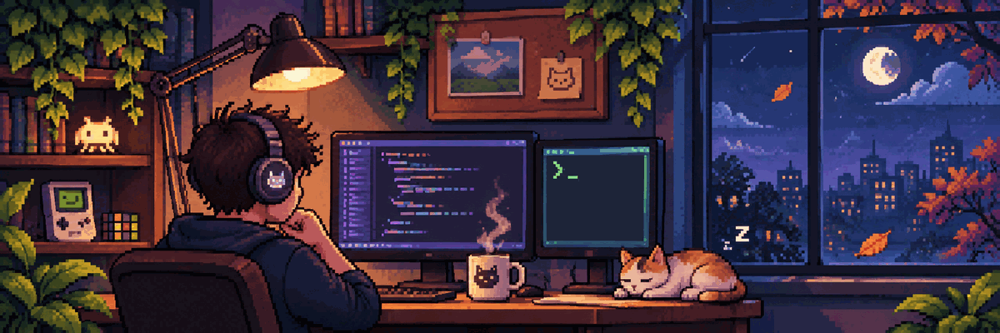

  

<h2 align="center">Hey, I'm Okan 👋</h2>

  I'm a Computer Engineering student from Türkiye. I enjoy turning ideas into useful things,
  learning through experimentation, and figuring out how things work beyond the surface.

## What I'm into

- **Software development:** I enjoy bringing ideas to life, exploring different approaches, and finding creative solutions to real-world problems.

- **Understanding systems:** I'm curious about what happens behind the scenes, how different components work together, and what makes things efficient, reliable, and maintainable.

- **Learning and experimenting:** I enjoy exploring new technologies, participating in hackathons, collaborating with others, and challenging myself with unfamiliar problems and ideas.

Outside of coding, I enjoy playing tennis, organizing events, and occasionally going on a side quest.

## GitHub activity

  

